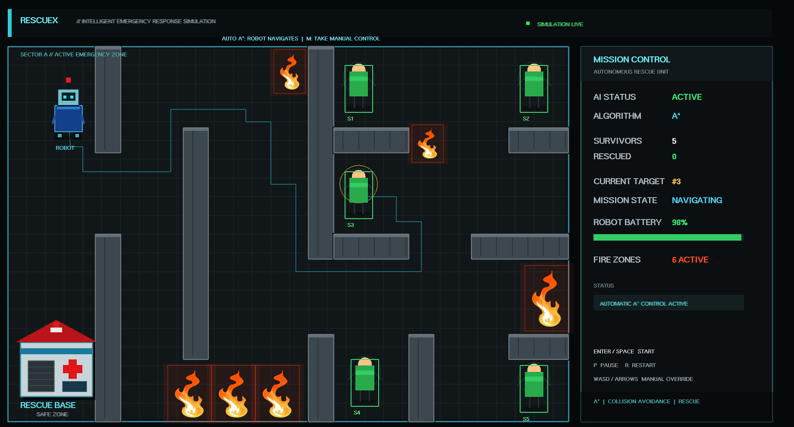
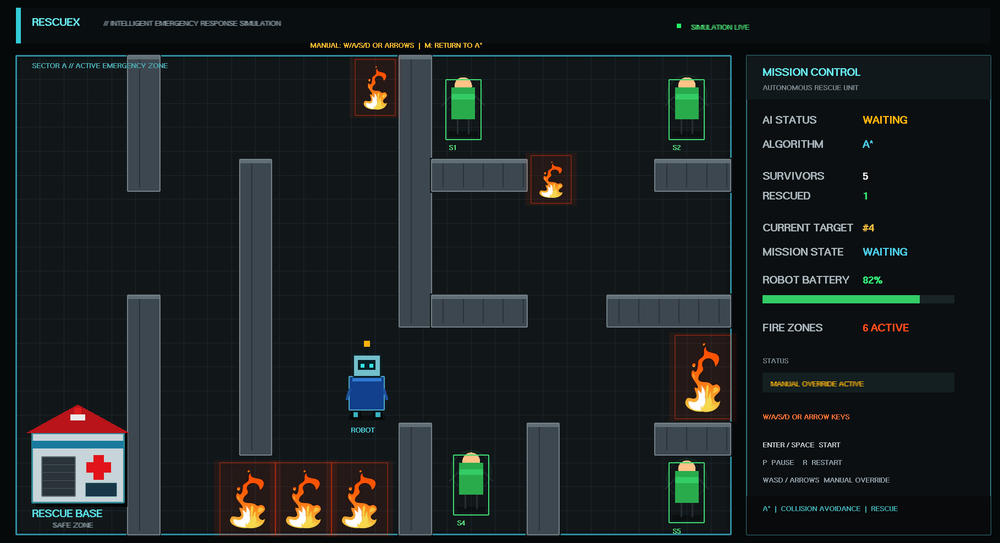
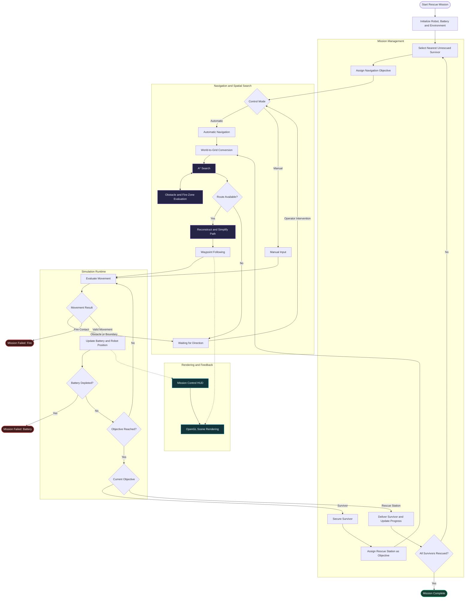
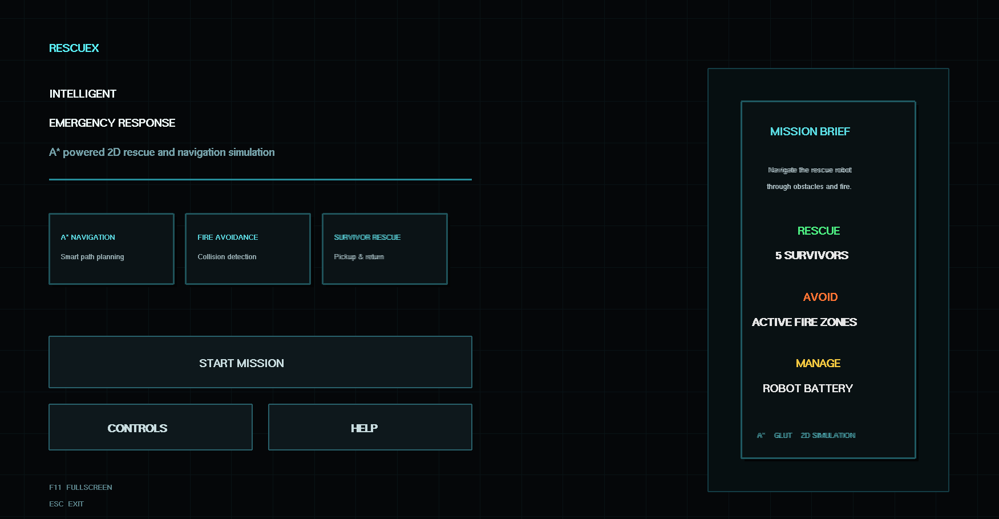
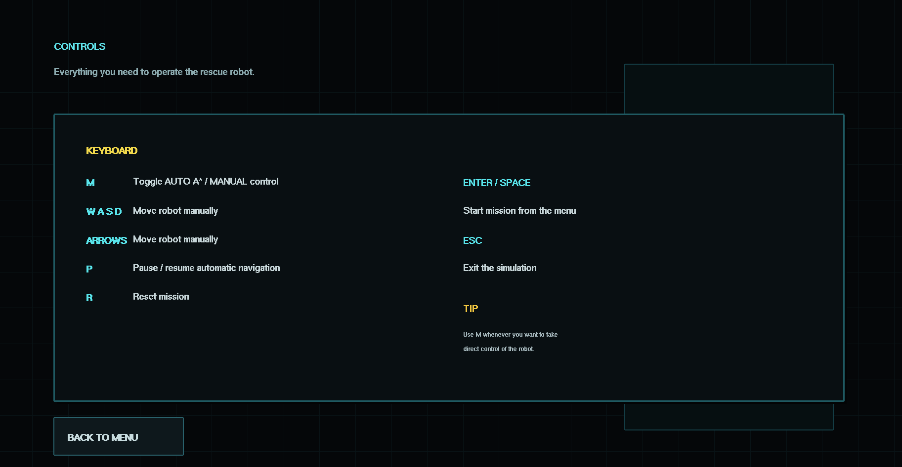
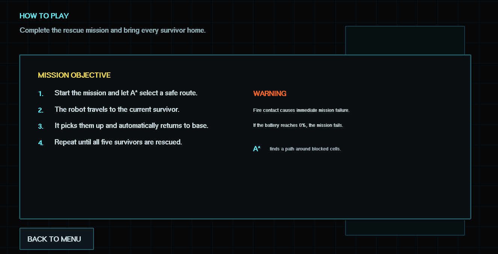
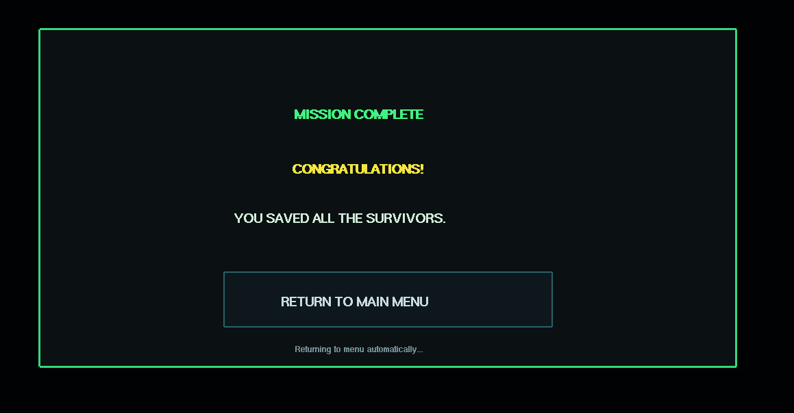
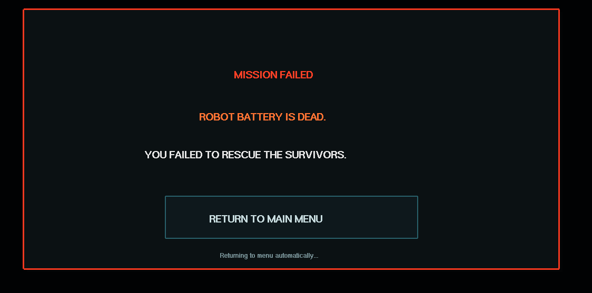
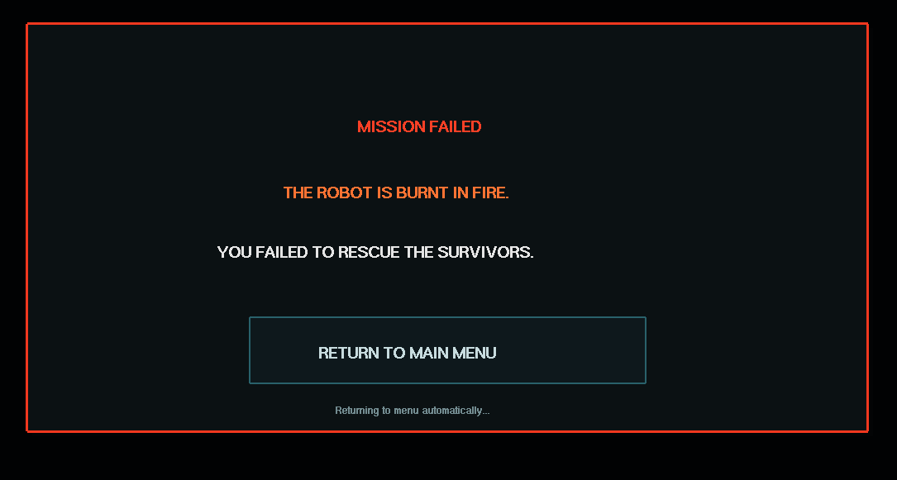

<div align="center">

  <h1>RescuePilot</h1>

  <p>
    <strong>Autonomous navigation when every decision matters.</strong>
  </p>

  <p>
    An interactive 2D rescue robot simulation exploring A* pathfinding,
    autonomous navigation, collision detection, and mission-oriented
    decision-making through C++ and OpenGL.
  </p>

  [](https://isocpp.org/)
  [](https://www.opengl.org/)
  [](https://freeglut.sourceforge.net/)
  [](#pathfinding-engine)
  [](#simulation)

  <p>
    <a href="#overview">Overview</a> ·
    <a href="#simulation">Simulation</a> ·
    <a href="#pathfinding-engine">Pathfinding</a> ·
    <a href="#system-architecture">Architecture</a> ·
    <a href="#gallery">Gallery</a> ·
    <a href="#getting-started">Getting Started</a>
  </p>

  

  <sub>
    Exploring autonomous navigation, spatial reasoning, and
    decision-making in a simulated emergency environment.
  </sub>

</div>

## Overview

RescuePilot is an interactive computer graphics project that explores
the application of autonomous pathfinding within a simulated emergency
response environment.

The simulation places a rescue robot inside a two-dimensional map
containing structural obstacles, hazardous fire zones, stranded
survivors, and a designated rescue station.

The robot must navigate the environment, locate survivors, and
transport them to the rescue station while operating within a limited
energy budget.

Unlike conventional shortest-path demonstrations, the simulation
integrates path planning into a broader mission lifecycle, where
navigation decisions interact with environmental constraints,
resource consumption, and operational objectives.

The project brings together several areas of computer science:

- Graph theory and heuristic search.
- Autonomous robot navigation.
- Computational geometry.
- Collision detection.
- Finite-state machines.
- Real-time computer graphics.
- Interactive simulation.

## Features

| Feature | Description |
| :--- | :--- |
| **Autonomous Navigation** | A* pathfinding for goal-oriented robot movement. |
| **Manual Control** | Interactive navigation using keyboard input. |
| **Control Switching** | Transition between autonomous and manual operation. |
| **Spatial Search** | Discrete grid representation of a continuous 2D environment. |
| **Collision Detection** | Geometric intersection checks for obstacles and fire zones. |
| **Route Simplification** | Removal of redundant collinear waypoints. |
| **Mission Management** | Survivor selection, pickup, transportation, and delivery. |
| **Battery Simulation** | Movement-dependent energy consumption. |
| **Mission States** | Navigation, waiting, returning, paused, completed, and failed states. |
| **Animated Environment** | Texture-based fire animations and real-time rendering. |
| **Mission Control HUD** | Visual feedback for navigation, battery, and rescue progress. |
| **Interactive Interface** | Main menu, controls, help screens, and fullscreen support. |

## Simulation

The simulation represents a rescue mission inside a bounded
two-dimensional environment.

<div align="center">

  

  <sub>Autonomous navigation with live mission information and route visualization.</sub>

</div>

### Mission environment

| Component | Configuration |
| :--- | :--- |
| Rescue Robot | 1 |
| Survivors | 5 |
| Fire Zones | 6 |
| Structural Obstacles | 11 |
| Rescue Station | 1 |
| Navigation Modes | Automatic and Manual |
| Navigation Grid | 45 × 31 |
| Grid Resolution | 20 world-coordinate units |
| Initial Battery | 100% |
| Base Window Resolution | 1261 × 700 |

The environment combines discrete graph-based navigation with
continuous robot movement and geometric collision detection.

### Navigation modes

<table>
  <tr>
    <td align="center" width="50%">
      <strong>Autonomous Navigation</strong>
    </td>
    <td align="center" width="50%">
      <strong>Manual Control</strong>
    </td>
  </tr>
  <tr>
    <td>
      
    </td>
    <td>
      
    </td>
  </tr>
  <tr>
    <td>
      The robot computes routes using A*, selects rescue objectives,
      and follows generated waypoints.
    </td>
    <td>
      The operator can take control of the robot and navigate
      the environment using keyboard input.
    </td>
  </tr>
</table>

Switching back to autonomous control triggers route computation
from the robot's current position toward its active objective.

## Pathfinding Engine

The navigation system uses the A* search algorithm to compute
routes through a discretized representation of the simulation world.

The search considers traversable positions, structural obstacles,
fire zones, map boundaries, and the physical radius of the robot.

### Heuristic evaluation

A* evaluates each candidate node using the following function:

$$
f(n) = g(n) + h(n)
$$

Where:

- $g(n)$ is the accumulated traversal cost from the starting node.
- $h(n)$ estimates the remaining distance to the destination.
- $f(n)$ determines the search priority of the candidate node.

The implementation uses Manhattan distance as its heuristic:

$$
h(n) = |x_n - x_g| + |y_n - y_g|
$$

This heuristic is consistent with the four-directional movement
model used by the navigation grid.

### Implementation characteristics

| Component | Implementation |
| :--- | :--- |
| Search Algorithm | A* |
| Heuristic | Manhattan distance |
| Open Set | `std::priority_queue` |
| Closed Set | Two-dimensional boolean matrix |
| Cost Model | Uniform grid traversal cost |
| Movement Model | Four-directional |
| Path Reconstruction | Parent-node backtracking |
| Route Simplification | Collinear waypoint elimination |
| Collision Model | Circle-to-rectangle intersection |
| Coordinate Mapping | World-to-grid and grid-to-world conversion |

### Spatial representation

The simulation maintains two complementary coordinate systems.

**World coordinates** represent the continuous spatial positions
used by OpenGL, robot movement, and collision detection.

**Grid coordinates** represent the discrete nodes evaluated
by the pathfinding algorithm.

The relationship between these representations is managed by:

- `worldToGrid()` — converts continuous positions into grid nodes.
- `gridToWorld()` — converts grid nodes into spatial positions.
- `gridBlocked()` — determines whether a grid node is traversable.

This separation allows the search algorithm to operate over a
discrete graph while the robot moves continuously between waypoints.

### Collision detection

The robot is represented by a circular collision boundary,
while obstacles and hazardous regions use rectangular geometry.

The collision system determines whether the circular boundary
intersects the corresponding rectangle.

This allows navigation decisions to account for the robot's
physical footprint rather than treating it as a dimensionless point.

The collision model is shared by path planning and movement
validation, with an additional clearance margin around fire zones.

### Route reconstruction and simplification

After reaching the destination, the search reconstructs the path
through stored parent-node references.

The resulting grid positions are converted into world coordinates,
and redundant intermediate waypoints are removed from straight
segments.

This produces a more compact route representation without
introducing arbitrary diagonal shortcuts.

## System Architecture

The simulation is organized around three interconnected
responsibilities: mission management, path planning, and
movement execution.

The following diagram illustrates the conceptual relationship
between these systems, including autonomous navigation,
manual intervention, and mission termination.



## Gallery

### Interface

<table>
  <tr>
    <td align="center" colspan="2">
      
      <br />
      <sub><strong>Main Menu</strong> — mission briefing and navigation.</sub>
    </td>
  </tr>
  <tr>
    <td align="center" width="50%">
      
      <br />
      <sub><strong>Controls</strong></sub>
    </td>
    <td align="center" width="50%">
      
      <br />
      <sub><strong>Mission Briefing</strong></sub>
    </td>
  </tr>
</table>

### Mission outcomes

<table>
  <tr>
    <td align="center" colspan="2">
      
      <br />
      <sub><strong>Mission Complete</strong> — all survivors rescued.</sub>
    </td>
  </tr>
  <tr>
    <td align="center" width="50%">
      
      <br />
      <sub><strong>Battery Depleted</strong></sub>
    </td>
    <td align="center" width="50%">
      
      <br />
      <sub><strong>Fire Collision</strong></sub>
    </td>
  </tr>
</table>

## Technology Stack

<div align="center">

  

</div>

| Technology | Responsibility |
| :--- | :--- |
| **C++** | Simulation logic, algorithms, and spatial data structures. |
| **OpenGL** | Two-dimensional graphics rendering. |
| **FreeGLUT** | Window management, event handling, and timer callbacks. |
| **GLU** | Orthographic projection utilities. |
| **stb_image** | Image loading and texture preparation. |
| **C++ STL** | Priority queues, vectors, and standard algorithms. |
| **GCC / MinGW** | Native application compilation. |


## Getting Started

### Requirements

- C++ compiler with C++11 support or later.
- OpenGL development libraries.
- FreeGLUT development libraries.
- GLU development libraries.
- A desktop environment supporting legacy OpenGL rendering.

The repository includes `stb_image.h`, so no separate installation
of the image-loading library is required.

### Clone the repository

```bash
git clone https://github.com/4beru/rescuepilot-robot-simulation.git
cd rescuepilot-robot-simulation
```

### Build on Linux

Install the required graphics development libraries.

**Arch Linux:**

```bash
sudo pacman -S --needed gcc freeglut glu
```

**Debian / Ubuntu:**

```bash
sudo apt install build-essential freeglut3-dev libglu1-mesa-dev
```

Compile the application:

```bash
g++ -std=c++17 -O2 src/main.cpp \
    -o rescuepilot \
    -lglut -lGLU -lGL
```

Run the simulation:

```bash
./rescuepilot
```

### Build on Windows

Using an MSYS2 MinGW environment with GCC and FreeGLUT installed:

```bash
g++ -std=c++17 -O2 src/main.cpp \
    -o RescuePilot.exe \
    -lfreeglut -lopengl32 -lglu32
```

Run the application:

```bash
./RescuePilot.exe
```


---

<div align="center">

  <h3>Every route has a purpose.</h3>

  <p>
    Part of <strong>Pathfinding Series</strong> — a collection of
    projects exploring graph theory, search algorithms,
    spatial computing, and creative visualization.
  </p>

  <p>
    <sub>Curated by Abel Ortega.</sub>
  </p>

  <a href="https://github.com/4beru">GitHub</a> ·
  <a href="https://www.aberu.site">Portfolio</a>

</div>
